# LittleChristmasTree

A small desk Christmas tree made of bent wire, eleven flickering LEDs and a 3D-printed "snow" base. The wire is both the frame and the circuit. No microcontroller, no firmware, just a switch, a resistor and two batteries.

  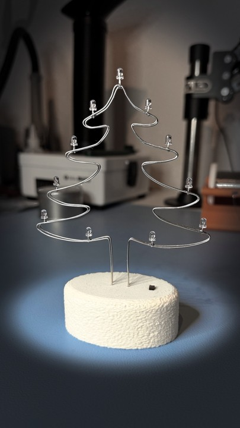
  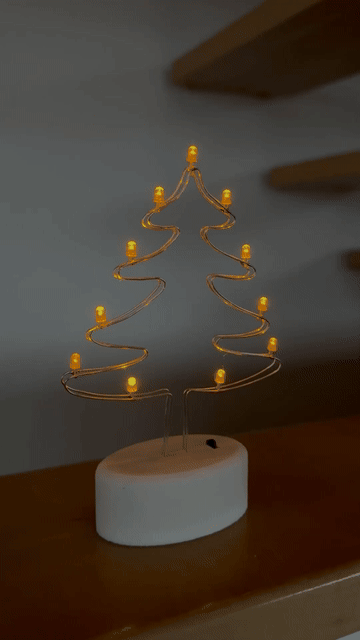

▶️ **Build video:** [youtube.com/@forgevolt](https://youtube.com/@forgevolt) <!-- TODO: replace with the direct video link -->

---

## How it works

The tree outline is bent from **two parallel bare wires** that run a few millimetres apart, up one side, over the top and down the other. One wire is **+**, the other is **−**. Each LED is soldered straight across the pair, so all 11 LEDs sit **in parallel** on the two rails.

The LEDs are **self-flickering "candle" LEDs**. A tiny controller chip inside each LED makes it flicker on its own, so every light flickers out of step with the others and no extra electronics are needed.

A small board (30.48 × 20 mm) inside the base connects everything. You can order it as a PCB from the Gerber files, or simply build it on a piece of perfboard:

  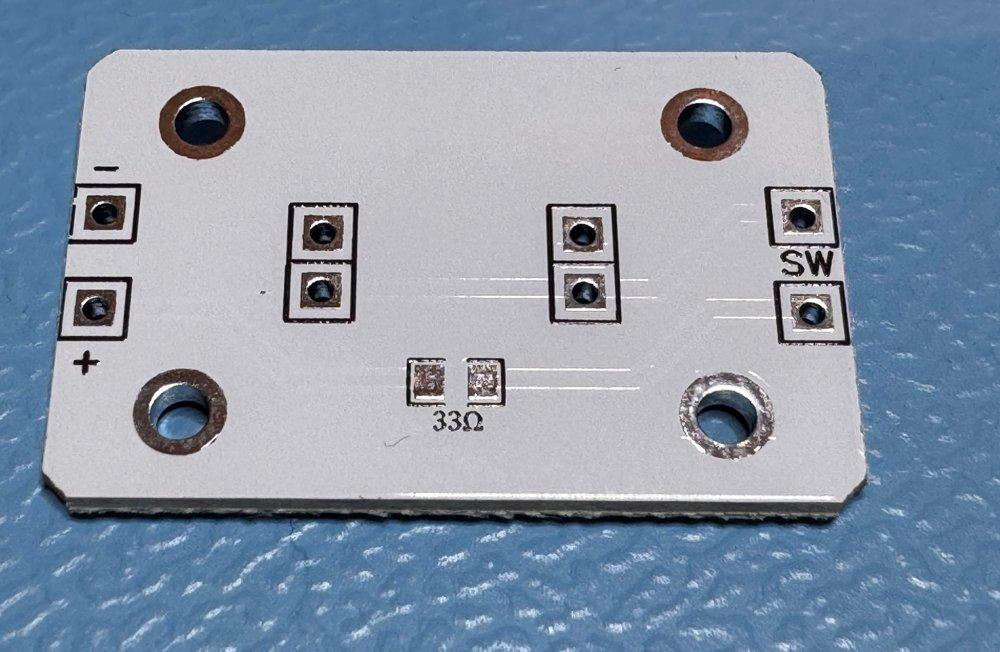
  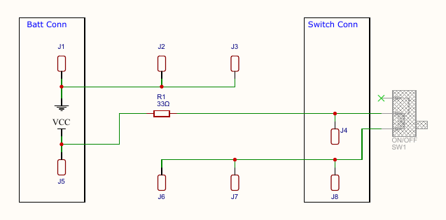

| Pad | Connects to |
|---|---|
| J1 / J5 | Battery − / + |
| J2 / J3 | Tree **−** rail (both wire ends) |
| J6 / J7 | Tree **+** rail (both wire ends), switched |
| J4 / J8 | Slide switch SW1 |
| R1 33 Ω | One series resistor that limits the current for all LEDs |

Full schematic: [`hardware/schematic.pdf`](hardware/schematic.pdf)

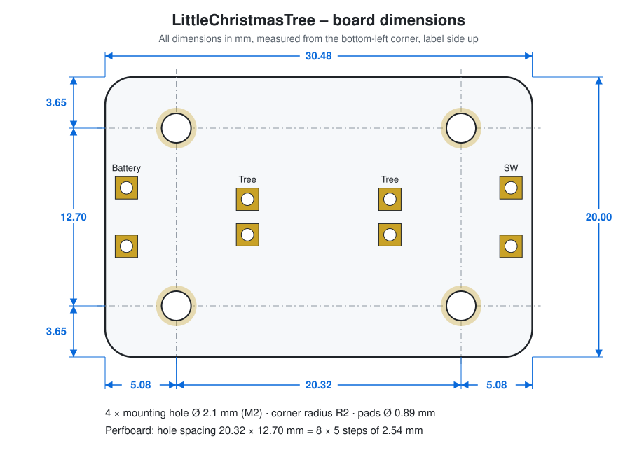

Board size, mounting holes and pad positions: [`hardware/BOM.md`](hardware/BOM.md#board-dimensions)

## Repository layout

| Path | Contents |
|---|---|
| `hardware/schematic.pdf` | Schematic |
| `hardware/easyeda/` | EasyEDA Pro project (`.epro2`) |
| `hardware/gerber/` | Gerber files, ready to order (e.g. JLCPCB). Optional: perfboard works too |
| `hardware/BOM.md` | Bill of materials |
| `mechanics/print-profiles/` | Bambu Studio projects (`.3mf`) for the base and battery holder, PLA and ABS-GF variants |
| `mechanics/stl/` | STL files for other slicers: `Housing`, `BatteryHolder`, `BatteryCover` |
| `mechanics/stl/jigs/` | STL files for the bending and soldering jigs |
| `mechanics/cad/` | Fusion 360 source file (`LittleChristmasTree.f3d`) |
| `images/` | Photos and renders used in this README |

## Bill of materials

| Qty | Part | Notes |
|---:|---|---|
| 11 | 3 mm flicker LED, clear lens, yellow | Self-flickering "candle" type. [AliExpress](https://www.aliexpress.com/item/1005007016428728.html), variant 3 mm / yellow |
| 1 | Resistor 33 Ω, 0805 | KOA RK73H2ATTD33R0F, LCSC [C317229](https://www.lcsc.com/product-detail/C317229.html) |
| 1 | Mini slide switch SS12F15, SPDT, with mounting ears and solder lugs | Screwed into the top of the base, wired to J4/J8. [AliExpress](https://www.aliexpress.com/item/10000003088863.html), or SHOU HAN SS12F15G5, LCSC [C2887260](https://www.lcsc.com/product-detail/C2887260.html) |
| 8 | Header pin 1×1, 2.54 mm (optional) | LCSC [C81276](https://www.lcsc.com/product-detail/C81276.html). Wires can also be soldered straight to the pads |
| 1 | PCB 30.48 × 20 mm (`hardware/gerber/`) **or** a piece of perfboard | Perfboard: cut to size and wire by hand |
| 2 × 60 cm | Tin-plated copper wire, Ø 0.8 mm | Length per wire before bending. Not silver-plated, see tip below |
| 2 | AAA battery | 3 V total |
| 2 + 2 | AAA battery contacts: 2× spring plate (−), 2× flat plate (+) | 9 × 14 mm, with solder tab. [AliExpress](https://www.aliexpress.com/item/32884289489.html) |
| 2 | Machine screw M2 × 8 (or M2 × 12), countersunk, Phillips | Battery cover (DIN 965 / ISO 7046), screwed into heat-set inserts |
| 2 | Heat-set insert M2 (Ø 3.0 mm outside, 3 or 4 mm long) | Melted into the printed part for the battery cover screws |
| — <!-- TODO: length --> | Stranded wire AWG 28 (Ø ≈ 0.32 mm), silicone insulation | Battery holder to J1/J5, switch to J4/J8, link between the two cells. Silicone doesn't melt when you solder |
| 2 | Self-tapping screw M2 × 5, Phillips | Switch mounting ears |
| 2 | Split lock washer M2 (spring washer, DIN 127) | Under the switch screws |
| 4 | Self-tapping screw M2 × 6, Phillips | PCB (4 mounting holes, Ø 2.1 mm), screwed straight into the printed base |
| 1 | Base + battery holder + cover | 3D printed, see below |

<table align="center">
  <tr>
    <td align="center"> 3 mm flicker LED (yellow)</td>
    <td align="center">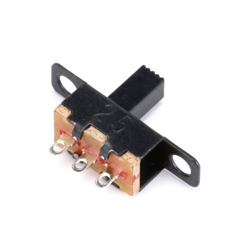 Mini slide switch with mounting ears</td>
    <td align="center">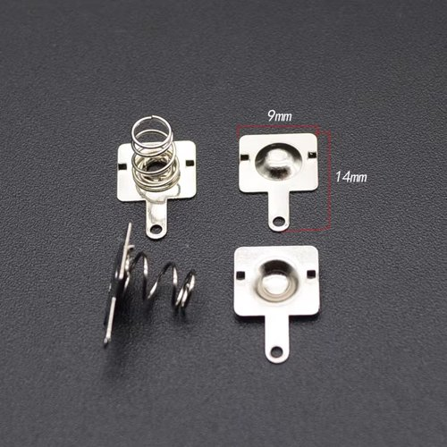 AAA battery contacts, spring (−) and flat (+)</td>
  </tr>
</table>

> **Wire tip:** Use **tin-plated copper wire**. Avoid **silver-plated** wire: the plating tends to flake off at the bends and tarnishes (turns dark) over time.

Details and notes: [`hardware/BOM.md`](hardware/BOM.md)

## 3D printing

  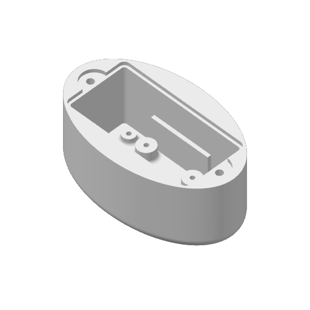
  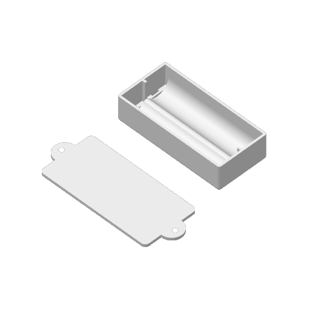

| Part | Size | Profile |
|---|---|---|
| Base (`Housing`) | 69 × 42 × 27.6 mm | 0.20 mm Standard, 4 walls, 15% gyroid, ironing on the topmost surface, no supports |
| Battery holder (`Body1`) + cover (`BatteryCover`) | 51 × 24 × 12 mm / 63 × 26 × 1.4 mm | 0.16 mm Balanced Quality, 4 walls, 15% gyroid, no supports |

The `.3mf` files in `mechanics/print-profiles/` are set up for a **Bambu Lab H2D** with a 0.4 mm nozzle. Each part comes in two versions: **PLA** (Bambu PLA Basic) and **ABS-GF**.

**The snow texture** on the side of the base is **painted fuzzy skin**. It's painted onto the model in Bambu Studio, so the global fuzzy-skin setting stays *off*. The 3MF files already include the painting. If you print from an STL in another slicer, turn fuzzy skin on for the outer wall only (thickness 0.3 mm, point distance 0.8 mm).

## Jigs

Five printed jigs make the wire tree accurate and repeatable. The STL files are in [`mechanics/stl/jigs/`](mechanics/stl/jigs/). They're easy to print: any material and any settings will do.

| | Jig | Used for |
|---|---|---|
| 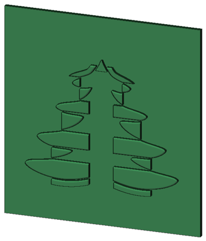 | **Bending jig** `BendingJig.stl` | Bend the wire pair into the Christmas tree shape |
| 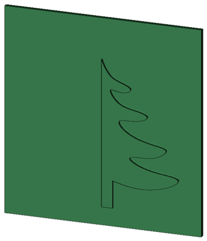 | **Tree jig** `TreeJig.stl` | Holds the bent wire for the final shaping |
|  | **Tree negative** `TreeNegativeJig.stl` | Pressed onto the wire in the tree jig to make the shape exact |
| 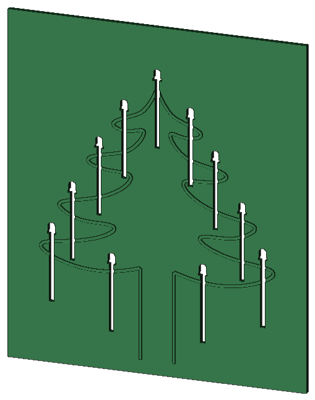 | **Soldering jig** `SolderingJig.stl` | Holds the tree and the LEDs while you solder them to the wire |
| 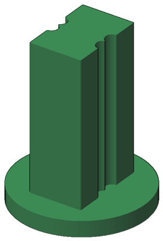 | **Standoff guide** `StandoffGuideJig.stl` | Keeps a defined distance when you solder the tree to the PCB |

## Build steps

1. **Make the board.** Either order the PCB from the Gerber files, or use a piece of perfboard (prototype board): cut it to 30.48 × 20 mm (12 holes wide on standard 2.54 mm perfboard, about 8 holes tall), drill the mounting holes ([positions](hardware/BOM.md#board-dimensions)) and wire it by hand following the schematic. Then solder R1 and (optionally) the header pins. On perfboard a through-hole 33 Ω resistor is easier to solder than the 0805 SMD part.

   > **Tip:** When you order the PCB, panelize it. 5 × 4 = 20 boards per panel cost almost nothing extra, which is enough for *many* Christmas trees.

2. **Print** the base, the battery holder, the cover and the five jigs. Then press the two M2 heat-set inserts for the battery cover screws into place with a soldering iron.
3. **Bend the wire pair.** Cut two 60 cm pieces of 0.8 mm tin-plated copper wire. **Straighten each piece first:** hold both ends with pliers and pull until the wire stretches slightly. That makes it perfectly straight and a little stiffer. Then bend both wires together into the tree shape using the **bending jig**, so they stay parallel. Small pliers with round jaws make the tight turns at the tips of the branches easier.
4. **Shape it exactly.** Put the bent wire into the **tree jig** and press the **tree negative** onto it. This makes the shape exact.
5. **Mark the polarity.** Decide which wire is + and which is − *before* soldering.
6. **Solder the LEDs.** Place the tree and the LEDs in the **soldering jig**. Put each LED with its longer leg (anode) on the + wire. Trim the legs and solder close to the LED body so it sits upright.
7. **Test the tree** with 3 V before you install it. A flicker LED put in backwards just stays dark.
8. **Install:** push the wire ends through the base and solder them to J2/J3 (−) and J6/J7 (+). Use the **standoff guide** to keep a defined distance between the tree and the PCB. Then screw the slide switch into the base by its mounting ears, wire it to J4/J8 (tin the stranded wire ends before soldering), and connect the battery holder to J1 (−) and J5 (+), screw the PCB in place and close the battery cover.

<!-- TODO: add photos for each step, or link chapter timestamps from the video -->

## Safety notes

- The wires are bare. That's harmless at 3 V, but a metal object across both rails will short the battery (R1 doesn't protect against that). Switch the tree off when you aren't watching it, and don't use it as a toy for small children.
- Don't run it at a higher voltage without changing R1.

## License

[MIT](LICENSE) © ForgeVolt

---

*Build. Test. Improve. Share.* — [ForgeVolt](https://github.com/forgevolt)
