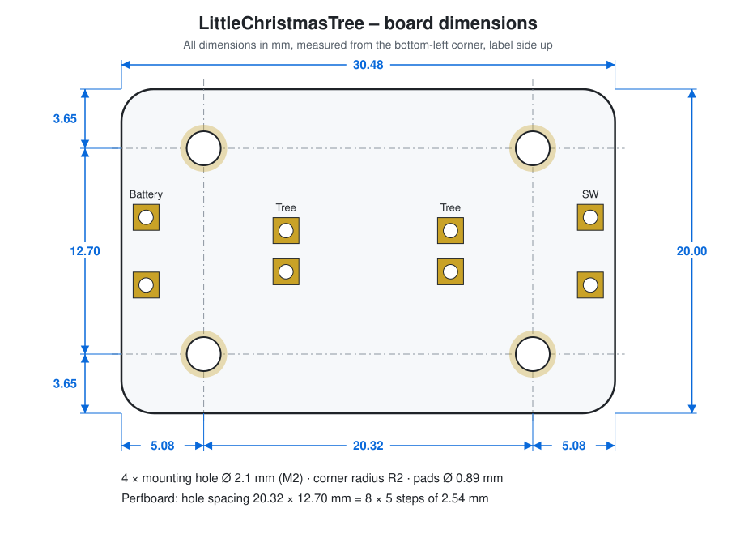

# Bill of materials

## Board (30.48 × 20 mm)

Order the PCB from `hardware/gerber/`, **or** build it on a piece of perfboard (prototype board): cut it to 30.48 × 20 mm (12 holes wide on standard 2.54 mm perfboard, about 8 holes tall), drill the mounting holes and wire it by hand following `hardware/schematic.pdf`. On perfboard, use a through-hole 33 Ω resistor (¼ W) instead of the 0805 SMD part.

> **Tip:** When you order the PCB, panelize it. 5 × 4 = 20 boards per panel cost almost nothing extra, which is enough for *many* Christmas trees.

| Ref | Qty | Part | Manufacturer part | LCSC | Package |
|---|---:|---|---|---|---|
| R1 | 1 | Resistor 33 Ω | KOA RK73H2ATTD33R0F | [C317229](https://www.lcsc.com/product-detail/C317229.html) | 0805 |
| SW1 | 1 | Mini slide switch ON/OFF, SPDT, SS12F15 type | SHOU HAN SS12F15G5, or any SS12F15 with mounting ears and solder lugs. Not on the PCB: screwed into the base by its mounting ears and wired to J4/J8. Source: [AliExpress](https://www.aliexpress.com/item/10000003088863.html) | [C2887260](https://www.lcsc.com/product-detail/C2887260.html) | Panel mount |
| J1–J8 | 8 | Header pin 1×1, 2.54 mm (optional) | — | [C81276](https://www.lcsc.com/product-detail/C81276.html) | THT |

## Tree

| Qty | Part | Specification | Notes |
|---:|---|---|---|
| 11 | Flicker LED | 3 mm, clear lens, yellow, self-flickering | Source: [AliExpress](https://www.aliexpress.com/item/1005007016428728.html), variant 3 mm / yellow. One spare is useful |
| 2 × 60 cm | Tin-plated copper wire | Ø 0.8 mm, bare | Length per wire before bending (1.2 m per tree). One wire is + and one is − |

> **Wire tip:** Use **tin-plated copper wire**. Avoid **silver-plated** wire: the plating tends to flake off at the bends and tarnishes (turns dark) over time.

## Power and enclosure

| Qty | Part | Notes |
|---:|---|---|
| 2 | AAA battery | 3 V |
| 2 | Battery contact, spring plate (−) | 9 × 14 mm, nickel-plated, with solder tab. Source: [AliExpress](https://www.aliexpress.com/item/32884289489.html) |
| 2 | Battery contact, flat plate (+) | 9 × 14 mm, nickel-plated, with solder tab. Same listing |
| — | Short wire link, AWG 28 stranded, silicone insulation | Connects the two cells in series (− of cell 1 to + of cell 2) |
| 1 | Base (`Housing`) | 3D printed, `mechanics/print-profiles/Base-*.3mf` |
| 1 | Battery holder (`Body1`) + cover (`BatteryCover`) | 3D printed, `mechanics/print-profiles/BatteryHolderCover-*.3mf` |
| 2 | Machine screw M2 × 8 (or M2 × 12), countersunk, Phillips | Battery cover. DIN 965 / ISO 7046, screwed into heat-set inserts |
| 2 | Heat-set insert M2 (Ø 3.0 mm outside, 3 or 4 mm long) | Melted into the printed part for the battery cover screws |
| 2 | Self-tapping screw M2 × 5, Phillips | Switch mounting ears |
| 2 | Split lock washer M2 (spring washer, DIN 127) | Under the switch screws |
| 4 | Self-tapping screw M2 × 6, Phillips | PCB (4 mounting holes, Ø 2.1 mm), screwed straight into the printed base |
| — | Stranded wire AWG 28 (Ø ≈ 0.32 mm), silicone insulation | Battery holder to J1/J5 and switch to J4/J8. Tin the ends before soldering. Silicone doesn't melt when you solder. TODO: length |

## Electrical notes

- Supply: 3 V (2 × AAA)
- All 11 LEDs are in parallel behind one 33 Ω resistor (R1).
- TODO: measured average current, and from that the battery life (≈ battery capacity in mAh ÷ current in mA).

## Board dimensions

Board: **30.48 × 20 mm**, corner radius 2 mm. Positions are measured from the **bottom-left corner**, looking at the side with the labels (battery −/+ on the left, SW on the right).

| Hole | Ø | X | Y |
|---|---|---|---|
| Mounting hole, bottom left | 2.1 mm | 5.08 mm | 3.65 mm |
| Mounting hole, bottom right | 2.1 mm | 25.40 mm | 3.65 mm |
| Mounting hole, top left | 2.1 mm | 5.08 mm | 16.35 mm |
| Mounting hole, top right | 2.1 mm | 25.40 mm | 16.35 mm |

The mounting holes are **20.32 mm apart horizontally** and **12.70 mm apart vertically**, both on the 2.54 mm grid (8 × 5 holes). On perfboard: pick one hole as the first mounting hole. The other three are 8 holes across and 5 holes up from it. Open those 4 holes up to 2.1 mm, then cut the board so that each mounting hole is 5.08 mm from the left or right edge and 3.65 mm from the top or bottom edge. The holes are centred on the board, so it comes out the same either way round.

Pad positions (Ø 0.89 mm)

| Pad | X | Y |
|---|---|---|
| Battery (2 pads) | 1.52 mm | 7.91 / 12.09 mm |
| Tree wires, left pair | 10.16 mm | 8.73 / 11.27 mm |
| Tree wires, right pair | 20.32 mm | 8.73 / 11.27 mm |
| Switch SW (2 pads) | 28.96 mm | 7.91 / 12.09 mm |

